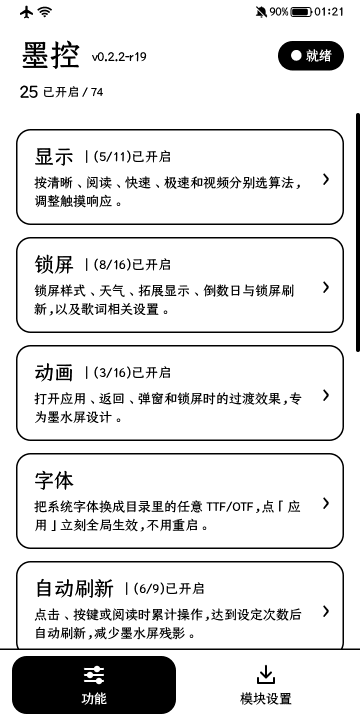
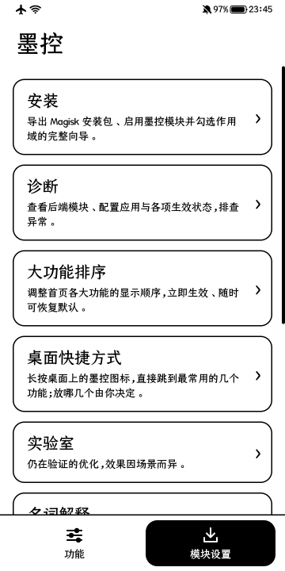
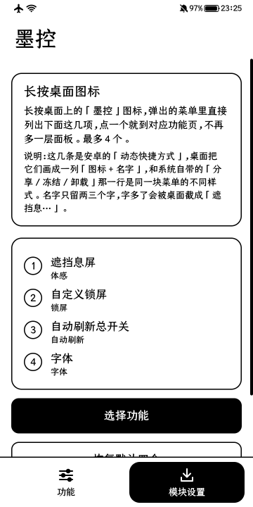
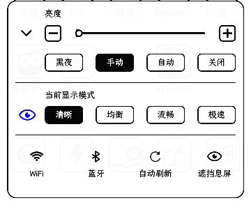
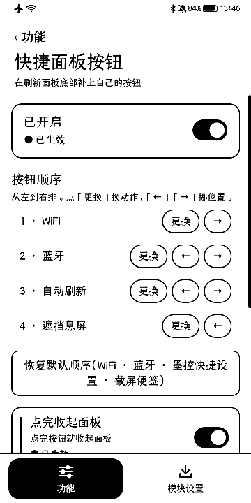
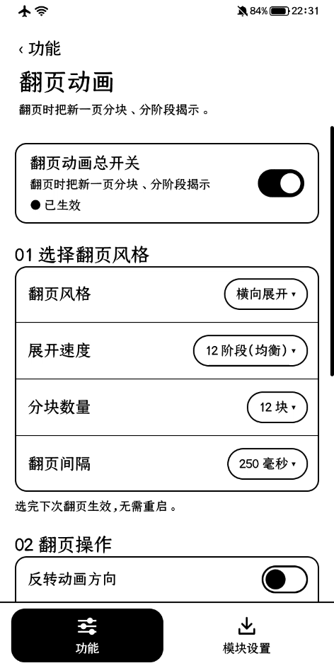
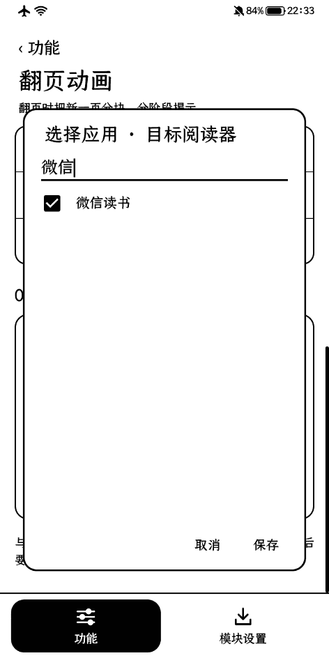

<a href="README.md">简体中文</a> · <a href="docs/wiki/README.en.md"><b>Docs</b></a> · <a href="docs/wiki/agent-handbook.en.md">Start here, agents</a> · <a href="https://github.com/wzp100/InkControl/releases">Downloads</a>

# More control over your E-ink display

**InkControl · 墨控** is a monochrome E-ink enhancement suite for the **Hisense A5 Pro 经典版 (Classic Edition)** (`HLTE203T` / Android 10 / arm64): one app manages display algorithms, transitions, page-turn animation, the lock screen, the stock launcher and system enhancements, paired with a Magisk backend module. **All enhancements ship off by default**; enable what you need. The UI shows configuration intent, runtime acknowledgement and faults separately. Packages and notes are on [Releases](https://github.com/wzp100/InkControl/releases); the app and backend module must be the same version.

> **Test devices only recommended: back up important data to a computer or independent storage first. Boot failure, permanent data loss, and unrecoverable device damage are possible. Read [risks and disclaimer](#risks-and-disclaimer) before installation.**

| Display | Motion | Page turn | Lock screen | Stock launcher | System | Fonts | Quick panel |
| --- | --- | --- | --- | --- | --- | --- | --- |
| Per-mode algorithms; grayscale and binary groups; independent hysteresis | Per-scene effects and previews on the existing display path | Banded reveal for listed reader apps, rendered by the GPU display backend | Six styles; weather, lyrics, notification count, device status and countdowns switched individually | Theme, icons and wallpaper chosen separately; long-press lists up to four shortcuts | Control-center tiles, white navigation keys, settings snapshots, system-app removal and restore | Replace the system font from a chosen font file | Extra buttons on the system E-Ink panel |

## Choose your starting point

| I want to… | Read |
| --- | --- |
| Install and get started | [Getting started](docs/wiki/getting-started.en.md) |
| Understand modes, video, and hysteresis | [Display algorithms](docs/wiki/algorithms.en.md) |
| Diagnose slow refresh or inactive settings | [Operations and recovery](docs/wiki/operations.en.md) |
| Continue development and understand prior work | [Agent handbook](docs/wiki/agent-handbook.en.md) → [Research](docs/wiki/research.en.md) |
| Read mechanism and process documents | [docs index](docs/README.md) (Chinese) |
| Locate code, evidence, and release automation | [Architecture](docs/wiki/architecture.en.md) · [Evidence](docs/wiki/evidence.en.md) · [Build and release](docs/wiki/build-and-release.en.md) |

## Getting started

1. Download a signed APK from [Releases](https://github.com/wzp100/InkControl/releases) and read that version's notes and checksums first.
2. Open **Install** in the app, check the environment, export the matching backend ZIP, and install it through Magisk.
3. Enable InkControl in an LSPosed-style framework and tick three scopes: System Framework, System UI, and the stock launcher.
4. Restart fully, confirm readiness on **Diagnostics**, then enable the features you need one by one.

Only `HLTE203T` / Android 10 / `arm64-v8a` is supported. The backend gates on the build number `L1732.6.01.02` and the exact stock display-library hash. Verified system software versions (`ro.software.version`) are `L1732.6.14.01.B10` (by the contributor) and `L1732.6.15.01.B10` (0.3.0-rc1 smoke test on 2026-11-11); both report the same build number. InkControl depends on the stock launcher, theme and display-backend internals, so **other models, system versions or modified ROMs are likely incompatible**. Without Root you can still browse guides and previews. The release signature is fixed, so an app with the old signature cannot be updated in place: back up configuration and uninstall it first. See [detailed steps and recovery](docs/wiki/getting-started.en.md).

## A look inside

<table><tr><th>Home</th><th>Module settings</th><th>Launcher shortcuts</th></tr><tr><td></td><td></td><td></td></tr></table>

<table><tr><th>E-Ink quick panel</th><th>Panel buttons</th></tr><tr><td></td><td></td></tr></table>

<table><tr><th>Page-turn animation</th><th>Target readers</th></tr><tr><td></td><td></td></tr></table>

The screenshots show the Chinese UI; the app also offers English under **Module settings → Language**. Sources, sizes and SHA256 are in [docs/media/README.md](docs/media/README.md). Captures show layout only, not panel grayscale or ghosting quality.

## Developers and agents

Start with [AGENTS.md](AGENTS.md) and the [agent handbook](docs/wiki/agent-handbook.en.md). [llms.txt](llms.txt) provides a short entry point; the [knowledge index](docs/wiki/knowledge-index.json) maps topics to code and evidence.

The feature catalog is the single configuration definition. The UI calls application services. See [contributing](CONTRIBUTING.en.md), [architecture](docs/wiki/architecture.en.md), and [localization](docs/localization.en.md).

The repository is public, with Chinese and English documentation under [`docs/wiki`](docs/wiki/README.en.md). Original code and artwork follow [MIT](LICENSE). Vendor binaries, third-party assets, and external frameworks retain their own terms; see [NOTICE](NOTICE.en.md). Keys, passwords, plaintext firmware, personal backups, and raw device logs stay outside Git.

[Publication and Wiki maintenance](docs/publication.en.md)

## Risks and disclaimer

This project is experimental and remains a release candidate. **Use a spare device or a dedicated test device; it is not recommended for a primary phone used for communication, payments, or important data.** Passing cloud builds and automated tests does not certify stability on a physical device or compatibility with every device and firmware.

Root, Magisk modules, system-framework hooks, and display-backend changes may cause freezes, boot loops, failure to boot, data loss, or device damage. **Some failures may be unrecoverable. Disabling, uninstalling, or rolling back the module is not guaranteed to recover the device or its data.**

**Before installing, upgrading, or enabling features, back up photos, documents, chats, app data, and important configuration. Copy the backup to a computer or other independent storage and check that it is readable. Do not keep the only backup on the phone being tested.** Prepare recovery materials and a recovery method matching the device and firmware. If you do not know how to disable a module or restore the system, do not proceed yet.

The project is provided as is, without a promise of fault-free operation, data preservation, or recovery. Understand the risks and decide whether to use it; see the warranty disclaimer in [LICENSE](LICENSE). A backup reduces the risk of losing data but does not guarantee that the device can be repaired.
