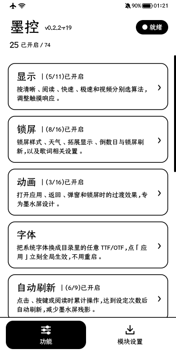
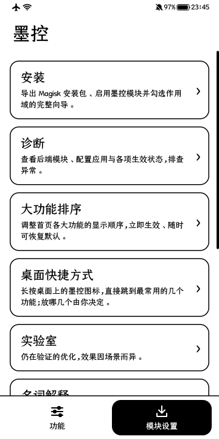
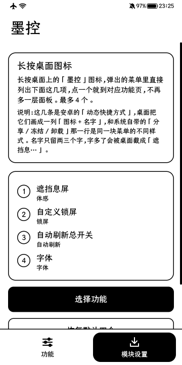
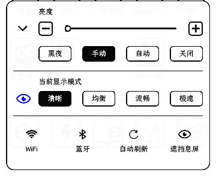
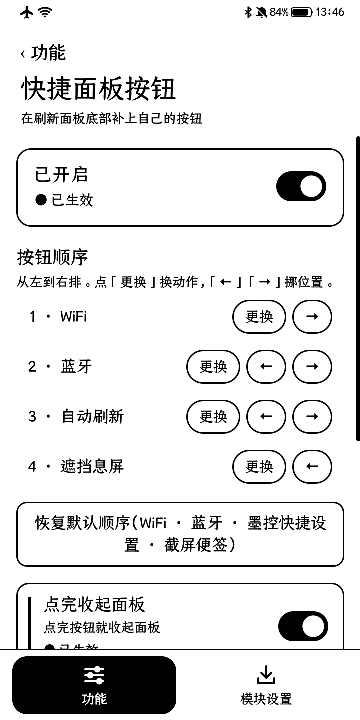

<b>中文文档（主）</b> · <a href="docs/wiki/README.md"><b>知识库</b></a> · <a href="docs/wiki/agent-handbook.md">Agent 从这里开始</a> · <a href="README.en.md">English</a> · <a href="https://github.com/liuqianhe/InkControl/releases">下载安装包</a>

# 黑白之间，多一点掌控

**墨控 · InkControl**，为 **Hisense A5 Pro 经典版**打造的黑白墨水屏增强套件。用一个应用管理显示算法、过渡动画、锁屏、原厂桌面与系统增强，内置与 App 匹配的 Magisk 后端。

**全部增强默认关闭**（只有锁屏「显示设备状态」的四项显示开关与「截屏便签对齐尺寸」默认开）。按需开启，保留原有选择；清楚展示期望配置、运行回执和异常状态。

| 显示 | 动画 | 锁屏 | 原厂桌面 | 系统增强 |
| --- | --- | --- | --- | --- |
| 四种模式分别选算法，视频独立设置 | 场景效果、预览、温度停留曲线 | 天气、歌词、通知数、设备状态四项、六套样式 | 三套主题，图标、壁纸、组件分别选择；长按图标直接列出最多四个常用功能 | 控制中心磁贴、三大金刚键漂白、系统字体更换、系统设置快照备份、系统应用卸载还原、冻结安全输入服务后的密码框修复 |
| 灰度与黑白分组，迟滞独立开关 | 复用显示链路，保留模式边界 | 逐项启停与条件恢复；通知数与设备状态二选一；倒数日 | 保留原厂布局和应用位置 | 逐项独立开关，关掉即回到原厂行为 |

> **建议仅用于测试机：先把重要数据备份到电脑或独立存储。可能出现无法开机、永久数据丢失或无法恢复的设备故障，安装前请阅读[风险提示与免责声明](#风险提示与免责声明)。**

## 先找到你的入口

| 我想…… | 阅读入口                                                                                                              |
| --- |-------------------------------------------------------------------------------------------------------------------|
| 安装和开始使用 | [使用  入门](docs/wiki/getting-started.md)                                                                        |
| 理解四个模式、视频和迟滞 | [显示算法](docs/wiki/algorithms.md)                                                                                   |
| 排查卡顿、GPU 回退、配置未生效 | [诊断与恢复](docs/wiki/operations.md)                                                                                  |
| 接手开发，理解已经做过什么 | [Agent 手册](docs/wiki/agent-handbook.md) → [研究与结论](docs/wiki/research.md)                                          |
| 找源码、证据与发布流程 | [源码架构](docs/wiki/architecture.md) · [证据索引](docs/wiki/evidence.md) · [构建与 Release](docs/wiki/build-and-release.md) |

## 使用方式

1. 从 [Releases](https://github.com/liuqianhe/InkControl/releases) 下载签名 APK，先看该版本说明与校验文件。版本后缀 `-rc16`／`-r19` 都是候选轮次，数字越大越新。
2. 安装后进入“安装”页，核对环境，从 App 导出配套后端 ZIP，交给 Magisk 安装。
3. 在 Vector／LSPosed 类框架中启用墨控，勾选系统框架、系统界面和原厂桌面作用域。
4. 完整重启，在“诊断”页检查当前状态，再逐项开启需要的功能。

适配门槛为 `HLTE203T / Android 10 / arm64`，后端另外核对固件指纹与 vendor 输入哈希（指纹串里写作 `L1732.6.01.02`，与本机的 `ro.software.version` 前缀不同，属同一版本）。无 Root 也可浏览说明、切换中英文、看预览及导出安装包。[详细步骤与恢复](docs/wiki/getting-started.md)。

> **已验证设备与系统：** 目前唯一完成实机验收的机型是**海信 A5 Pro 经典版 `HLTE203T`**，Android 10（API 29），`arm64-v8a`，系统固件 **`L1732.6.14.01.B10`**（`ro.software.version`；`ro.build.display.id` 为 `QP1A.190711.020`，`ro.build.fingerprint` 仍写作 `L1732.6.01.02`）。墨控直接依赖该固件的原厂桌面（`com.hmct.vision`）、原厂主题与显示后端内部实现，**其他机型、其他系统版本或改版 ROM 很可能不适配**，不保证可用或可恢复；换机或升级系统前请先按下方风险提示评估并做好备份。

> **签名迁移：** rc13 起使用固定的新发行签名，不能覆盖安装旧签名 App。首次迁移先备份配置并卸载旧 App，再安装新版及其配套后端；后续继续沿用该签名。

## 界面一览

<table><tr><th>功能首页</th><th>模块设置</th><th>桌面快捷方式</th></tr><tr><td></td><td></td><td></td></tr></table>

0.2.2-r19 在 `HLTE203T` 上的**真机截屏**（720×1440 位图，等比缩到 360×720）。左图是功能首页：右上角是当前就绪状态，下面一行是「已开启 / 总数」；中图是「模块设置」：安装向导、诊断、大功能排序、桌面快捷方式、实验室、名词解释，以及底部的语言与提示时长（列表可继续下滚）；右图是「模块设置 → 桌面快捷方式」，长按桌面图标时按这个顺序列出四项。截屏只能说明版式，不代表面板灰阶与残影观感。英文翻译已停止维护（[英文文档](README.en.md) 仍在，但界面里的部分文字会显示中文）。

<table><tr><th>E-Ink 快捷面板</th><th>快捷面板按钮</th></tr><tr><td></td><td></td></tr></table>

上面两张是 **0.2.3-r20** 的同机截屏。左边是 **E-Ink 快捷面板**本身：SystemUI 自带的悬浮窗，从屏幕下缘升起、占住下半屏，上面是亮度与当前显示模式，底部一排四格现在可以由墨控接管（图上依次是 WiFi、蓝牙、自动刷新、遮挡息屏），点一下就地开关，提示落在屏幕底部；面板底色半透明，会透出后面桌面的图标。右边是 App 里「系统增强 → 快捷面板修改」直达的**快捷面板按钮**页：总开关、四行「序号 · 动作」各带「更换」与「←」「→」、「恢复默认顺序」，以及「点完收起面板」「截屏便签对齐尺寸」两个页内开关。

## 当前进度

源码为 **0.2.4-r21** 候选，包含分模式算法、独立迟滞、自动刷新（点击／按键／阅读界面计数与周期触发）、锁屏通知数（默认系统可清除通知，可切微信未读）与**锁屏设备状态**（无线网络／蓝牙／声音模式／飞行模式四项，与通知严格二选一）、六套自定义锁屏样式（编辑排版、瑞士网格、像素【纯白背景】、编辑排版-横、编辑排版-横-逆、液态玻璃）、控制中心拓展（快捷设置的「编辑磁贴」里列出第三方应用的磁贴）、E-Ink 刷新面板底部的四个按钮可自定义（WiFi／蓝牙／铃声／飞行模式／手电筒／自动旋转／整屏翻页／免打扰／省电模式／悬浮球／自动刷新／锁屏主题／遮挡息屏／墨控快捷设置／原厂截屏便签，也能换成任意一个应用或留空；长按 WiFi、蓝牙跳系统设置，长按墨控那三项跳对应功能页；按钮提示走系统默认的底部位置）、三大金刚键漂白（底部导航栏白底黑键）、系统设置快照备份（恢复出厂后逐条写回）、系统应用卸载还原、桌面长按直接列出最多四个常用功能、体感息屏与移开唤醒、大功能页统一紧凑布局（下拉与单行开关）、双语界面（英文翻译已停止维护）、统一图标和文档知识库。仓库带 GitHub Actions 工作流（`.github/workflows/build.yml`），但这台设备上目前的两次 Release 都是在本机用同一套检查构建并签名的：打包前跑 `check_docs.py` 与 `check_repository.py`（另有 `tools/test.py` 可跑单元测试），Release 里附 SHA256 校验和。相同版本不覆盖已有 Release。

2026-11-03 更新本机（`HLTE203T`）实机状态：**App 与后端模块均为 0.2.2-r19**，`sys.inkcontrol.ready=1`、无 `error`／`disable_hwc`、`helper_loaded=true`；系统设置快照实测 418 项（三张 `settings` 表）；长按桌面图标直接列出四项（遮挡息屏 / 自定义锁屏 / 自动刷新 / 字体），与系统自带的「分享 / 冻结 / 卸载」同处一个弹窗；「编辑磁贴」候选由 5 个变为上百个第三方磁贴；导航栏暗像素 100% → 2.26%，静置 60 秒模块日志 0 行。以上均为单机单次实测，不等于面板观感、功耗、温区与长期稳定验收；历史首个 GPU 错误根因未确定；本固件 Google split 图标覆盖未通过，保持关闭。[验证范围](docs/wiki/evidence.md)。

2026-11-06 本机（`HLTE203T`）升到 **0.2.3-r20**，App 与后端模块同批重装并整机重启：`sys.inkcontrol.ready=1`、模块目录无 `error`／`disable_hwc`，设备内 APK 与构建产物字节一致；快捷面板按钮的提示已回到屏幕底部（此前为避免被面板压住而抬到顶部），面板与按钮页见上方「界面一览」。

## 给开发者和 agent

先读 [AGENTS.md](AGENTS.md) 和 [Agent 手册](docs/wiki/agent-handbook.md)。[llms.txt](llms.txt) 提供精简入口，[知识索引](docs/wiki/knowledge-index.json) 提供结构化导航和来源定位。

功能目录是唯一配置定义，界面只调用应用服务。[参与开发](CONTRIBUTING.md) · [架构](docs/wiki/architecture.md) · [文档维护](docs/localization.md)。

仓库公开维护，中文与英文知识库见 [中文知识库](docs/wiki/README.md) 与 [`docs/wiki/*.en.md`](docs/wiki/README.en.md)。原创实现与标识采用 [MIT](LICENSE)；厂商二进制、第三方素材及外部框架适用各自权利，见 [NOTICE](NOTICE.md)。私钥、密码、明文固件、个人备份和原始设备日志不入 Git。

[公开前审查与文档维护](docs/publication.md)

## 风险提示与免责声明

本项目仍处于实验和候选验证阶段，**建议仅在备用机或专用测试机上使用，不建议用于承担通信、支付或重要数据存储的主力机**。云端构建、自动测试通过不代表已完成实机稳定性验收，也不保证兼容所有设备或固件。

Root、Magisk 模块、系统框架钩子及显示后端改动可能造成死机、反复重启、无法开机、数据丢失或设备损坏；**部分故障可能无法恢复，现有停用、卸载和回退机制不保证一定能救回设备或数据**。

**安装、升级或启用功能前，先备份照片、文档、聊天记录、应用数据和重要配置，并将备份复制到电脑或其他独立存储，确认能够读取。不要只把备份留在被测试的手机上。** 提前准备与当前设备、固件匹配的恢复材料及恢复方式；不清楚如何停用模块或恢复系统时，请先不要尝试。

项目按原样提供，不承诺无故障、无数据损失或可恢复。请充分了解风险，自行决定是否使用；许可中的无担保说明见 [LICENSE](LICENSE)。备份能降低数据损失风险，但不能保证设备一定可修复。
